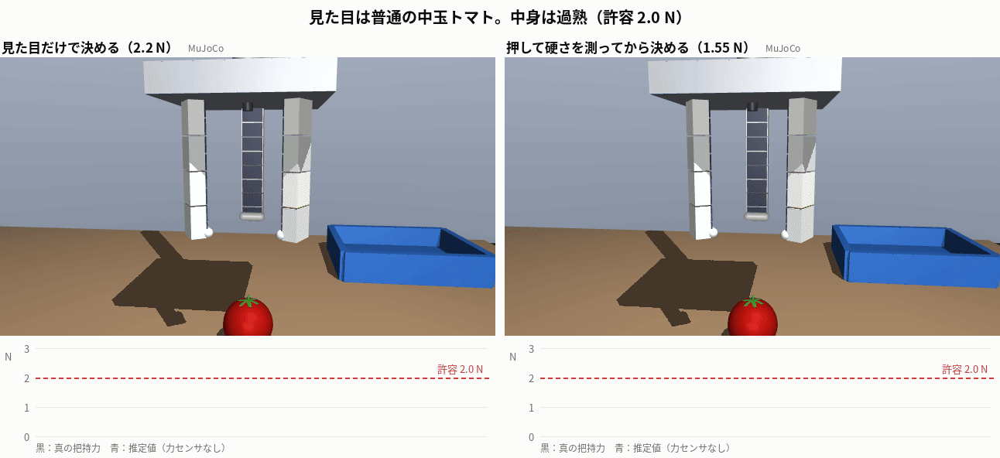
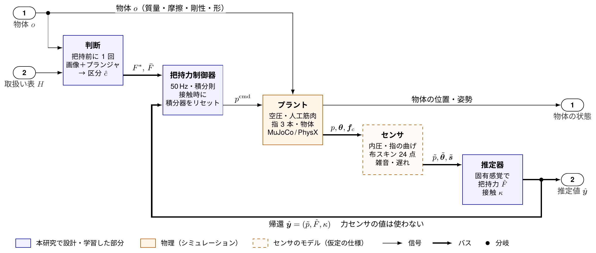
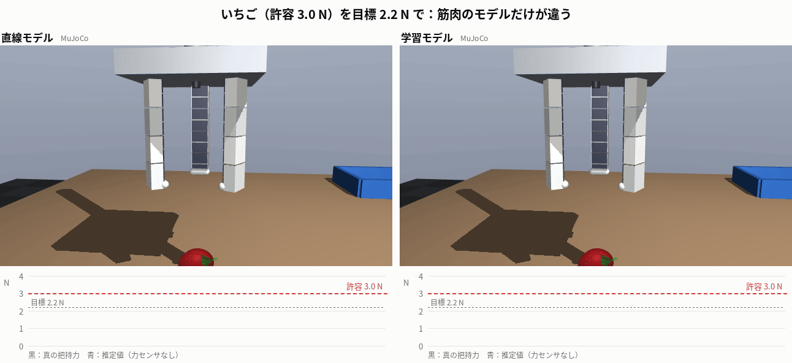
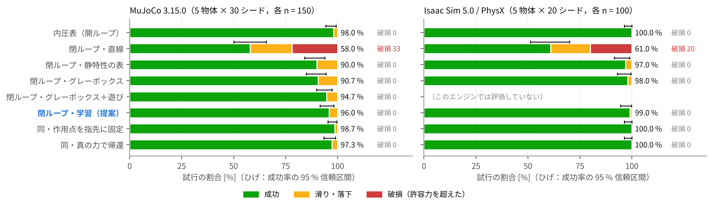
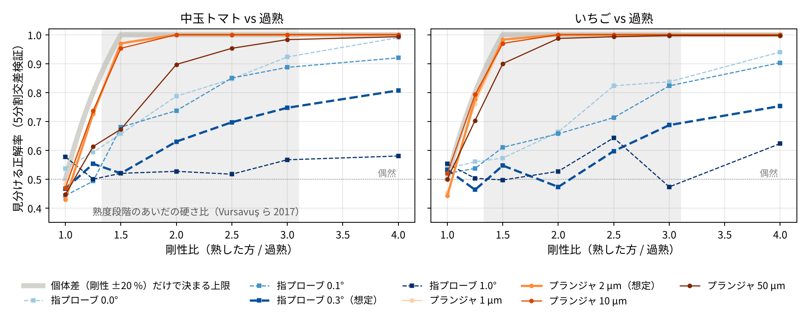
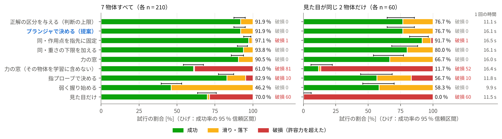
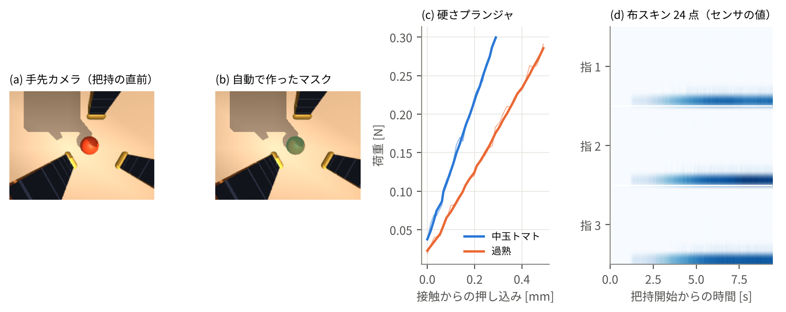
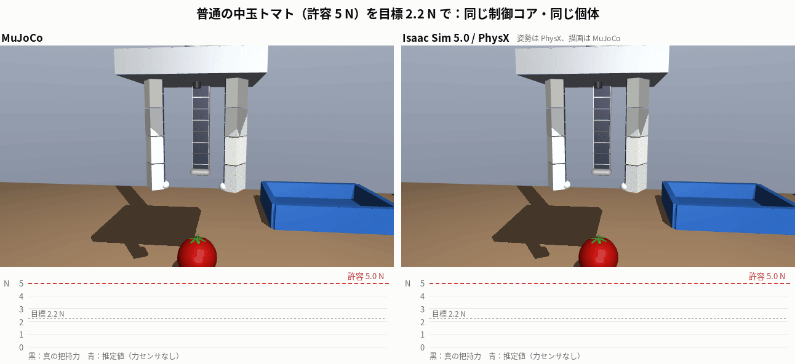
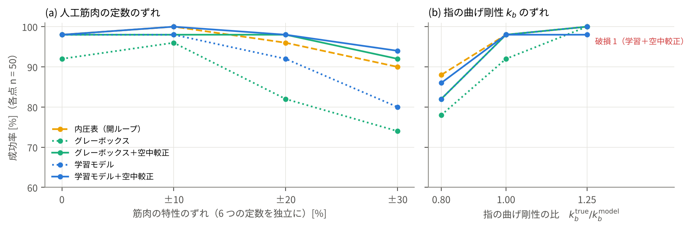

<!-- generated from docs/templates/README.template.md by scripts/make_numbers.py -->
# SoftTwin — 見た目が同じでも中身が違う食品を、力センサのない柔らかい指で壊さずにつかむ

[](https://github.com/Qu0rise/softtwin/actions/workflows/ci.yml)

コード Apache-2.0 ／ データ CC BY 4.0 ／ Physical AI 講座 2026 応用編1 最終課題



過熟の中玉トマトは、カメラには普通のトマトに見えます。見た目から「トマト＝2.2 N」で握ると潰れます（左）。
SoftTwin は把持の前に直径 8 mm のプランジャで 0.3 N だけ押して硬さを測り、柔らかい区分の 1.55 N で握ってトレーに置きます（右）。
指は空圧のシリコーン人工筋肉で、力センサはありません（ここでいう力センサは、指先のロードセルのように把持力を直接測るセンサです。スキンの出力は作用点の重み付けと接触判定に、プランジャの荷重計は握る前の硬さ測定にだけ使います）。把持力は、指の曲げ不足と、布状の触覚スキンが示す力の作用点から推定します。

| 結果 | |
| --- | --- |
| 力センサなしの閉ループ（5 物体 × 30 シード） | 成功 96.0 %、破損 0 / 150。直線の筋肉モデルでは 58.0 %（いちごを全数破損） |
| 力の推定誤差（接触中） | 作用点をスキンで求めると 0.14 N、指先と仮定すると 0.26 N |
| 見た目が同じ 2 物体 | 見た目で決めると 0 %（全数破損）→ プランジャで決めると 76.7 %、破損 0（正解の区分を与えた上限と同じ。目標の 85 % には未達） |
| 指で触るだけで見分けられるか | 過熟（硬さ 1/2.5）の判別は中玉トマト 70 %、いちご 60 %。プランジャなら 100 % |
| 物理エンジンを Isaac Sim（PhysX）に替える | 学習モデルの閉ループは PhysX でも 99.0 %・破損 0（5 物体 × 20 シード）。直線モデルの成否は同じ個体で 97/100 一致（Cohen の κ_C = 0.95） |
| 物体の大きさが調整時と違う（1.2 倍） | 内圧表（開ループ）は過熟トマトを 9 回潰す。閉ループは 0 回だが、重くなった物を落とす |

- 説明資料（PDF）：[`docs/paper/softtwin_report.pdf`](docs/paper/softtwin_report.pdf)　1 枚の要約：[`docs/paper/softtwin_summary.pdf`](docs/paper/softtwin_summary.pdf)
- 物理パラメータと文献：[`docs/physical_parameters.md`](docs/physical_parameters.md)　評価の数え方：[`docs/evaluation_protocol.md`](docs/evaluation_protocol.md)
- 数字の出どころ：[`results/metrics.json`](results/metrics.json)（このページの数字と説明資料の数字は、どちらもここから自動で書き出しています）

## 何をしたか

1. **一つの制御コア、二つの物理エンジン。** 物体の個体・筋肉・センサ・推定器・制御器・成否の判定を [`sim_mujoco/twin_core.py`](sim_mujoco/twin_core.py) にまとめ、MuJoCo と Isaac Sim 5.0 の PhysX はどちらも指と物体の動力学だけを受け持ちます。同じシードなら同じ個体（質量・摩擦・剛性・置き場所）を扱います。
2. **物理を文献値に合わせる。** 果実の接触剛性を N/mm で与え（トマトの硬さ 1.16〜3.58 N/mm、Vursavuş ら 2017 など）、MuJoCo では実効質量を測定から同定して目標の ±1 % 以内に合わせました。PhysX でも同じ手順で測っています。
3. **作用点を触覚で求める固有感覚推定。** 指の曲げ不足 Δθ から力を求めるには、作用点が必要です：$\hat F_f = k_b\,\Delta\theta_f / \bar\Lambda_f$。$\Lambda(\xi)=\sum_j (\xi-\xi_j)^+$（$\xi$ は指に沿った位置） はてこの和で、$\bar\Lambda_f$ はスキン 8 点の出力で重み付けた $\Lambda$ の平均です。
4. **センサ構成を判別マップから決める。** 剛性比と雑音を掃引すると、想定した曲げセンサの雑音（0.3°）では、指で触るだけで文献の熟度差（比 1.3〜3.1）を見分けきれません。そこで掌に硬さプランジャを加えました。



外部入力は左端（物体、取扱い表）、出力は右端です。帰還は推定値の束 $\hat{\boldsymbol y}$ だけで、力センサの値は使いません。各ブロックの中身は [`docs/figures/fig_block_detail.png`](docs/figures/fig_block_detail.png)。

## Q1：力センサなしで潰さず落とさないか



| 方式（MuJoCo、各 n = 150） | 成功 | 破損 | 推定誤差 |
| --- | --- | --- | --- |
| 内圧表（開ループ、区分ごとに調整） | 98.0 % | 0 | — |
| 閉ループ・直線の筋肉モデル | 58.0 % | 33 | 1.10 N |
| 閉ループ・静特性の表 | 90.0 % | 0 | 0.33 N |
| 閉ループ・グレーボックス | 90.7 % | 0 | 0.27 N |
| 閉ループ・学習（提案） | 96.0 % | 0 | 0.14 N |
| 同・作用点を指先に固定 | 98.7 % | 0 | 0.26 N |
| 同・真の力で帰還 | 97.3 % | 0 | — |

直線モデルは把持に使う 15〜24 kPa で自由曲げを小さく見積もり、力も小さく見積もるので、いちごを全数潰しました。
不感帯と飽和を表せるモデル（表・グレーボックス・学習）はどれも破損 0 でした。差は豆腐の落下に出ます。把持中の推定値÷真値は、表 1.16、グレーボックス 1.14、学習モデル 1.04 です。

この偏りを、推定の入力を 1 つずつ真値に置き換えて分解しました（`scripts/estimator_error_split.py`、5 物体 × 10 シード）。

| 推定値÷真値 | 全体 | 筋肉モデル | 曲げセンサ | スキン | 作用点 |
| --- | --- | --- | --- | --- | --- |
| 静特性の表 | 1.164 | 1.101 | 1.001 | 1.000 | 1.052 |
| グレーボックス | 1.138 | 1.075 | 1.001 | 1.000 | 1.051 |
| グレーボックス＋遊び | 1.058 | 1.013 | 1.001 | 1.007 | 1.047 |
| 学習モデル | 1.041 | 0.980 | 1.001 | 1.008 | 1.046 |

センサの雑音の寄与は 1 % 以下で、偏りは筋肉モデルと作用点の 2 項で決まります。作用点の項は約 +5 %（指先の丸みで触れると、接触点がスキンの最も先端側の点より外側にあるため）。把持中の筋肉は履歴の上昇側の枝にいるので、履歴を持たないモデルは自由曲げを大きく見積もり、作用点の項と同じ向きに重なります。履歴（遊び要素）を加えたグレーボックスは、閉ループで 94.7 % でした。ただし模擬筋肉そのものが同じ要素で作られているので、このモデルは構造を最初から知っています。学習モデルは構造を仮定せずに同じ水準に届きました。そのためには、同定データに接触後のゆっくりした増圧（1〜5 kPa/s）を入れる必要がありました。
区分が分かっていて、物体が調整に使ったものと同じ大きさなら、内圧表（開ループ）も閉ループと同じくらい強い基準です。エンジンを替えても、筋肉がずれても両者の差は小さいままでした。閉ループの利点は、物体の大きさが調整時と違うときに破損を減らせることです（下の「大きさが変わったら」）。



## Q2：見た目が同じ物体を見分けられるか



指は果実より 16〜61 倍柔らかく（指先のコンプライアンス 0.041 m/N）、果実のへこみは指自身のたわみに埋もれます。
想定した曲げセンサの雑音（0.3°）では、剛性比 2.5 で見分けられるのは中玉トマト 70 %、いちご 60 % です。
掌のプランジャは上面を 0.3 N だけ押して傾き $k_p$ を測ります。傾きには上面と台側の接触、手のたわみが直列に入りますが、手のたわみは個体によらないので判別を妨げません。想定の雑音では、剛性比 1.5 でトマト 97 %、比 2 以上で 100 % です。

| 目標把持力の決め方（7 物体 × 30 シード） | 成功 | 破損 | 見た目が同じ 2 物体 | 1 回の時間 |
| --- | --- | --- | --- | --- |
| 見た目だけ | 70.0 % | 60 | 0.0 % | 11.5 s |
| 弱く握り始め、滑ったら強める | 46.2 % | 0 | 58.3 % | 9.9 s |
| 指プローブで決める | 82.9 % | 10 | 56.7 % | 11.8 s |
| 硬さプランジャで決める（提案） | 91.9 % | 0 | 76.7 % | 16.1 s |
| 同・作用点を指先に固定 | 97.1 % | 1 | 91.7 % | 16.5 s |
| 同・重さの下限を加える | 93.8 % | 0 | 80.0 % | 16.1 s |
| 力の窓を学習（区分を使わない） | 90.5 % | 0 | 66.7 % | 16.0 s |
| 力の窓（その物体を学習に含めない） | 61.0 % | 81 | 11.7 % | 16.4 s |
| 正解の区分を与える（判断の上限） | 91.9 % | 0 | 76.7 % | 11.1 s |

プランジャで決めたときの失敗 17 件は、正解の区分を与えた上限の失敗と同じ試行で、すべて搬送中の落下でした。判断の誤りはなく、残る失敗は握り方に起因します（重い過熟トマト、指のあいだから抜ける過熟いちご、滑りやすい豆腐）。作用点を指先に固定すると力を 1 割強めに握るので落下が減り 91.7 % になりますが、過熟いちごを 1 回潰しました。推定はそのままに、見た目の種類ごとの名目質量と摩擦係数から目標の下限を上げると（下の「大きさが変わったら」）、過熟トマトと豆腐の落下が減って 80.0 %（破損 0）になります。残る過熟いちごは力を上げる余地がなく、握り方を変える必要があります。



## Q3：生成データだけで判断を学習できるか



420 試行（156,423 サンプル）を 2 CPU で 3.8 分で生成し、全試行が検証器を通りました。区分の正解率（5 分割交差検証）は、画像のみ 67.9±6.2 %、画像＋指プローブ 76.9±7.6 %、画像＋プランジャ 99.8±0.5 % です。
LeRobotDataset v2.1 の構成にも書き出せます（`scripts/export_lerobot.py`）。

## 物理エンジンを替える（MuJoCo → Isaac Sim 5.0 / PhysX）



制御コアは同じまま、指と物体の動力学だけを PhysX（コンプライアント接触、TGS、1 kHz）に替えました。
同じシードは同じ個体なので、試行ごとに突き合わせられます。学習モデルの閉ループは PhysX で 99.0 %（同じ個体の MuJoCo で 96.0 %）、破損はどちらも 0 です。両エンジンとも成功がほぼ全数なので、一致数そのものは目安にとどまります。失敗の多い直線モデルでは成否の一致が 97/100（Cohen の κ_C = 0.95）で、いちごは PhysX でも全数潰れました。7 方式全体（700 組）では不一致が 42 件あり、そのうち 30 件は、MuJoCo で落ちた豆腐を PhysX では運べたものです（PhysX ではどの方式でも豆腐を落としませんでした）。
柔らかい 3 物体では同じ個体のピーク力の差は中央値 1.1 %、硬い卵とボルトでは 22 % で、差は搬送の加減速の瞬間にだけ出ます。
動画と図 1 の果実の形・へた・指の色は描画専用で、質量も接触も持ちません（接触の計算は球と楕円体のまま。付けても外しても同じ試行の結果が一致することを `tests/test_render_only_visuals.py` で確認）。実行環境の GPU ドライバが Isaac Sim 5.0 の RTX 描画に対応していないため、PhysX は描画なしで計算しました。動画の右は、PhysX が計算した姿勢を MuJoCo の描画器で表示したものです。

## 筋肉と指が想定とずれたら



筋肉の 6 つの定数を ±30 % ずらすと、学習モデルの成功率は 80 % に下がります。空中較正で実測とモデルの差を足すと 94 % まで回復しました（同じ条件の内圧表は 90 %）。
指の曲げ剛性 $k_b$ のずれは力の推定にそのまま比例して入り、空中較正では見えません（25 % 硬いとピーク÷目標が 1.01 から 1.26 へ）。実機ではロードセルを一度押す校正が要ります。

## 物体の大きさが変わったら

内圧表（開ループ）は、調整に使った大きさの物体でしか力を保証しません。脆い 3 物体と過熟トマトの寸法を 0.8 倍・1.2 倍にしました（質量は 3 乗、両方式に正しい区分を与える、各 n = 80）。

| 倍率 | 内圧表：成功 | 破損 | ピーク÷目標 | 閉ループ：成功 | 破損 | ピーク÷目標 | ＋重さの下限：成功 | 破損 |
| --- | --- | --- | --- | --- | --- | --- | --- | --- |
| 0.8 | 74/80 | 0 | 0.86 | 80/80 | 0 | 1.10 | 80/80 | 0 |
| 1.0 | 72/80 | 0 | 1.03 | 72/80 | 0 | 1.06 | 77/80 | 0 |
| 1.2 | 58/80 | 9 | 1.20 | 46/80 | 0 | 1.06 | 54/80 | 1 |

閉ループは大きさによらず目標の約 1.1 倍で握り、1.2 倍でも潰しません。ただし大きく重い豆腐と過熟トマトを搬送中に落とし、成功率は内圧表を下回りました。内圧表は大きい物ほど強く握るので落下は減りますが、許容力の幅が狭い過熟トマトでは、その強さが破損になります。

物体が大きくなって変わるのは、潰さない力の上限ではなく落とさない力の下限です。そこで、カメラで測った大きさから推した重さで目標の下限を上げました（$F^* = \min(\max(H_{\rm t}, S\hat m(g+a)/\hat\mu), 0.85H_{\rm lim})$、$S$ は等倍の物体だけから決めた 2.5）。等倍の過熟トマトは目標が 1.55 → 1.70 N になって落下が減りますが、1.2 倍の過熟トマトに要る 3.3 N は許容力 2.0 N を超え、潰さず落とさない力の幅がありません。これは握る前に計算で分かるので、実際の工程では見送って別の把持に回すのがよいと考えます。

## 開発に使っていないシードでの確認

取扱い表と評価物体は開発中に評価シード 0〜29 の結果を見て見直したので、最終の構成を固定して、一度も使っていないシード 30〜59 で Q1 と Q2 を再実行しました。

| | シード 0〜29 | シード 30〜59 |
| --- | --- | --- |
| Q1 閉ループ・学習（成功・破損） | 96.0 %・0 | 94.7 %・0 |
| Q1 閉ループ・直線（成功・破損） | 58.0 %・33 | 58.0 %・32 |
| Q2 見た目だけ（見た目が同じ 2 物体） | 0.0 %・破損 60 | 0.0 %・破損 60 |
| Q2 プランジャで決める（提案） | 76.7 %・破損 0 | 81.7 %・破損 0 |
| Q2 同・重さの下限を加える | 80.0 %・破損 0 | 88.3 %・破損 0（区間 [77.8, 94.2]） |

重さの下限の係数はシード 0〜19 だけで決めたので、右の列はその独立な検証です。

## 制約

- 評価はすべてシミュレーションです。人工筋肉とセンサは仮定した特性のモデルで、このグリッパの実機は未製作です。
- 果実は剛体の外形と接触の柔らかさで近似し、局所的な変形と損傷の進行は扱っていません。許容力は卵以外は仮定値です。
- 過熟の剛性比（2.5）は仮定で、判別マップで比への依存を示しました。物体の位置はシミュレーションの真値です。
- PhysX で評価したのは Q1 だけです。
- 提案方式の目標力は区分だけで決めました。重さの下限（大きさの節）は名目の質量と摩擦を使い、個体の重さは見ていません。
- 次は、空圧アクチュエータと空圧回路の実機で人工筋肉 1 本の内圧と曲げを記録し、筋肉モデルを学び直します（把持の評価はグリッパの製作後）。

## 再現する

```text
pip install -r requirements.txt
unzip -n data/tactile_dataset.zip -d data/
python scripts/analysis_stats.py && python scripts/make_numbers.py      # 生データ -> metrics.json -> 本文と README の数字
python sim_mujoco/softtwin_mj.py bench --seeds 2 --out /tmp/q1.json     # Q1 をシード 0-1 で再実行（約 1 分）
python scripts/check_determinism.py /tmp/q1.json                        # 公開した行と一致するか
pytest -q
```

すべての実験を最初から回す手順と所要時間は [`docs/reproducibility.md`](docs/reproducibility.md) にあります（2 CPU で約 1 時間、PhysX は別に約 3 時間）。

## 構成

| 場所 | 内容 |
| --- | --- |
| `sim_mujoco/` | 制御コア `twin_core.py`、MuJoCo のセル、触覚とプランジャの特徴、データ生成と Q2、PhysX の記録の再生、動画 |
| `sim/isaac_headless/` | Isaac Sim 5.0 / PhysX のセル（USD）と、描画を使わない Kit アプリ |
| `learning/` | 筋肉のモデル（MLP・グレーボックス）、区分の分類器、力の窓 |
| `scripts/` | 接触剛性の合わせ込み、判別マップ、頑健性、統計、図、本文の数字 |
| `results/` | すべての数字の元データ（1 試行 1 行）と `metrics.json` |
| `core/`、`ros2/`、`firmware/` | 実機用：同じ制御コアを呼ぶ制御器、ROS 2 ノード（アクション・サービス）、M5Stack（設計のみ） |
| `docs/` | 物理パラメータ、評価の数え方、設計判断、モデルカード、実機への移行、説明資料、図 |

## English summary

SoftTwin grasps look-alike soft foods (an overripe mid-size tomato that looks like a ripe one) with a soft pneumatic gripper that has no force sensor.
One control core (object instances, muscle, sensor models, estimator, controller, outcome labels) runs unchanged on MuJoCo and on Isaac Sim 5.0 / PhysX; contact stiffness is set in N/mm from the literature and identified in both engines.
The grip force is estimated from the bending deficit caused by the contact, divided by the lever-arm sum weighted with the fabric skin readings (contact MAE 0.14 N);
closed-loop grasping succeeds in 96.0 % with 0/150 crushed (linear muscle model: 58.0 %, all strawberries crushed).
A discrimination map shows that squeezing with the soft fingers cannot reliably tell ripe from overripe at realistic stiffness ratios (70 % for tomatoes at ratio 2.5), so an 8 mm flat plunger probes the top first:
look-alike success rises from 0 % (all crushed) to 76.7 % with no crush; the remaining failures are drops on exactly the trials that also fail with the true class given (target 85 %, not met).
A per-class pressure recipe is as good when the objects match the ones it was tuned on, but at 1.2x size it crushes the overripe tomato 9 times (closed loop: 0, but it drops the heavier objects; a weight-based force floor helps until the floor exceeds the allowable force).
All evaluation is in simulation; the muscle and the sensors are assumed models.

## ライセンスと引用

コードは Apache-2.0、データ（`data/`）は CC BY 4.0 です。引用は [`CITATION.cff`](CITATION.cff) を使ってください。
